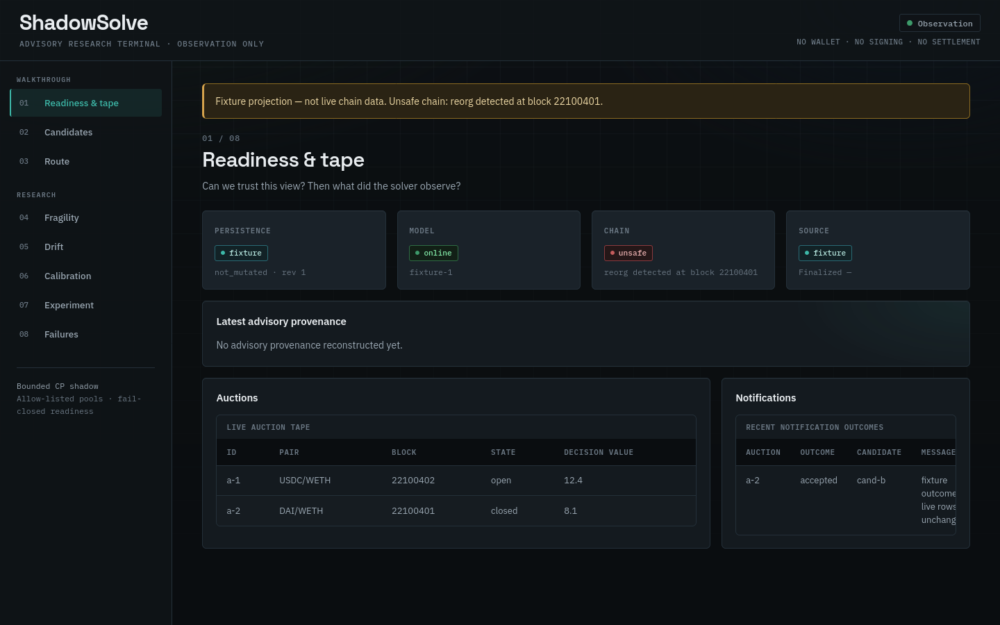

# ShadowSolve: advisory shadow solver for constant-product auctions

[](https://github.com/RahilBhavan/shadowsolve/actions/workflows/ci.yml)
[](LICENSE)

ShadowSolve ranks routes through allow-listed constant-product (Uniswap V2 style) pools for a single order and records why it chose them. It is advisory only: it holds no keys, signs nothing and submits no transactions. A Rust HTTP solver reads chain state through read-only JSON-RPC, stores each advisory with its provenance in PostgreSQL, and serves a static dashboard with no JavaScript dependencies and self-hosted fonts (no external requests). Python code handles offline replay, model training and walk-forward evaluation.



*The dashboard in fixture mode (`index.html?fixture=1`), 1440 px wide, rendered with Playwright Firefox on 2026-10-24. The banner marks fixture data, not live chain state.*

## What it does

- Solves one order over allow-listed pools on one configured chain: direct hops, an optional two-pool split, and allow-listed multi-hop routes of at most 2 hops.
- Fails closed. `/ready` returns 503 and `/solve` refuses when ingested state is stale, unsafe or non-canonical (for example after a finalized reorg).
- Stores each advisory transactionally with network, block, hash, route, surplus and model metadata.
- Serves content-addressed model artifacts: Python exports hashed JSON, Rust validates hash and feature schema, and falls back to a deterministic static score if validation fails.
- Publishes a walk-forward report on a synthetic feature stream (below). It is a methodology check, not market evidence.

### Walk-forward result (synthetic data)

Source: `reports/walk-forward/report.json` (sha256 `245c39b4…a4a3`, 10 chronological folds). Lower is better.

| Model | Brier | Log loss |
|---|---:|---:|
| base_rate | 0.2721 | 1.0452 |
| boosted_tree | 0.2778 | 1.0672 |
| logistic | 0.3856 | 1.7581 |

The boosted tree does not beat the base rate on this stream. The stream is synthetic, so these numbers say nothing about live MEV performance.

Provenance hashes reproduced on Python 3.9–3.14 on Linux: floats are rounded to 10 decimals before hashing and before the report is written, so last-bit differences in `exp` and `log` do not change the sha256 (a value sitting exactly on a rounding boundary could still differ). Regenerating the report with `python3 scripts/publish-walk-forward.py` gave the same sha256 on Python 3.12.14, 3.13.15 and 3.14.7 (Linux). A pytest test (`research/test_walk_forward.py`) regenerates the report and compares it with the committed manifest. Rounding moved the stored metric values by at most 5e-11 compared with the earlier unrounded file, so the four-decimal figures above are unchanged.

## How it works

Browser dashboard, then solver HTTP API (`/solve`, `/notify`, `/ready`, `/health`, `/metrics`, `/api/dashboard`), then PostgreSQL. An optional ingestion worker follows finalized blocks. Rust crates: `crates/pool-math` (swap math), `crates/solver-engine` (HTTP service, routing, model loading), `crates/state-ingestion` (RPC, canonical chain, Postgres), `crates/domain` (shared types). Python in `research/shadowsolve` does replay, training, export and walk-forward. See [docs/architecture.md](docs/architecture.md).

## Run it

Prerequisites: Docker with Compose; Rust 1.97.0 (pinned in `rust-toolchain.toml`); Python 3.12; Node 22.

```sh
cp .env.example .env
docker compose up --build
```

The dashboard is at `http://localhost:5173` and the solver at `http://localhost:8080`. `/solve` and `/notify` are dry-run advisories. Set `SHADOWSOLVE_DASHBOARD_MODE=fixture` for a labelled non-live dashboard. Ingestion is off by default; to enable it, set `SHADOWSOLVE_INGESTION_ENABLED=true`, `SHADOWSOLVE_RPC_URL` (your own RPC endpoint) and `SHADOWSOLVE_INGESTION_POOLS`.

Tests:

```sh
cargo fmt --check
cargo clippy --workspace --all-targets --locked -- -D warnings
cargo test --workspace --locked          # 71 tests
python3 -m pip install -r requirements-dev.txt
python3 -m pytest                        # 180 tests
python3 tests/mock_rpc.py --self-check
node src/self-check.js
python3 scripts/verify-pinned-pool.py --self-check
bash tests/e2e-shadow-stack.sh           # Docker end-to-end: reorg, restart, dedupe, metrics
```

Counts observed on 2026-10-24: 71 Rust tests (domain 2, pool-math 5, solver-engine 39 + 14, state-ingestion 11) and 180 pytest tests, all passing with Rust 1.97.0. `test_rust_serialized_candidate_contract` calls `cargo`; pytest skips it with a message when `cargo` is not on `PATH`. CI also runs `cargo audit --deny warnings` against `Cargo.lock`, and Dependabot proposes weekly updates for Cargo, pip, GitHub Actions and the Dockerfiles. No Rust test is ignored. The Docker end-to-end script was not re-run for this pass.

## Repository layout

- `crates/`: Rust workspace (domain, pool math, solver engine, state ingestion)
- `research/`: Python replay, training, export and walk-forward code, SQL, and its tests
- `src/`, `index.html`, `styles.css`: static dashboard (plain JavaScript, no build step)
- `fonts/`: self-hosted WOFF2 fonts (IBM Plex Sans, IBM Plex Mono, Space Grotesk) with their SIL OFL 1.1 license texts
- `scripts/`: pool verification and walk-forward publishing
- `tests/`: mock RPC, fixtures and the Docker end-to-end script
- `infra/`: Dockerfiles, nginx config and Postgres migrations
- `reports/walk-forward/`: published walk-forward report and manifest
- `docs/`: design, operations and research documents

## Documentation

- [docs/architecture.md](docs/architecture.md): how the pieces fit together
- [docs/runbook.md](docs/runbook.md): operating the local stack
- [docs/limitations.md](docs/limitations.md): what the system does not do
- [docs/threat-model.md](docs/threat-model.md): trust boundaries
- [docs/protocol-pins.md](docs/protocol-pins.md): the pinned Uniswap V2 USDC/WETH pool
- [docs/methodology.md](docs/methodology.md), [docs/model-card.md](docs/model-card.md), [docs/experiment-preregistration.md](docs/experiment-preregistration.md): research method
- [docs/data-dictionary.md](docs/data-dictionary.md): field definitions
- [docs/design-notes.md](docs/design-notes.md): three design questions with code pointers

## Sources

The pinned pool (Uniswap V2 USDC/WETH on Ethereum mainnet) is documented in `docs/protocol-pins.md` and checked offline by `scripts/verify-pinned-pool.py`. The walk-forward data is synthetic and generated in-repo; the report is content-addressed by sha256.

## Scope and limits

- Independent project; not affiliated with Uniswap or any auction operator.
- One chain, allow-listed constant-product pools, one order, at most 2 hops.
- Non-goals: concentrated liquidity, multi-order optimization, wallets, signing, execution, settlement and live PnL claims.
- No live profitability result exists. Walk-forward numbers come from synthetic data.
- Not run against a mainnet RPC for this write-up. The tests use a mock RPC.
- The screenshot shows fixture data. No screenshot of live data exists because the stack was not run against a mainnet RPC.
- The fonts are Latin-subset only. The fonts keep their own OFL licenses; the MIT license covers this project's code.

## License

MIT. See [LICENSE](LICENSE).

Part of [Rahil Bhavan's projects](https://github.com/RahilBhavan).
